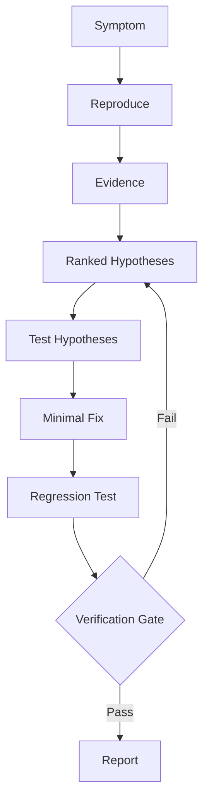

# Evidence-First Debugger

A Claude skill that investigates bugs using evidence, ranked hypotheses, minimal fixes, and regression tests.

**Differentiator:** it refuses to claim a fix works without verification.


---

## Table of Contents

- [Overview](#overview)
- [Core Principles](#core-principles)
- [How It Works](#how-it-works)
- [Verification Statuses](#verification-statuses)
- [Repository Structure](#repository-structure)
- [Installation](#installation)
- [Usage](#usage)
- [Example](#example)
- [Contributing](#contributing)
- [License](#license)

## Overview

Most debugging assistance fails in one of two ways: it guesses a cause from the first plausible symptom, or it declares success without running anything. This skill enforces a different discipline. Claude must observe before theorizing, keep several hypotheses alive, make the smallest possible change, prove the fix with a test that fails before and passes after, and report an honest verification status.

## Core Principles

1. **Evidence before theory.** No cause is proposed until something has been observed.
2. **Ranked hypotheses.** At least two to three candidates, each with a falsifying check.
3. **Minimal fix.** Only the change the confirmed root cause requires.
4. **Regression test.** Must fail on the original code and pass on the fixed code.
5. **No unverified success claims.** A fix is a hypothesis until executed.

## How It Works




| Phase | Goal | Reference |
|-------|------|-----------|
| 1. Symptom and reproduction | Pin down expected vs actual; reproduce and minimize | [01-symptom-and-reproduction.md](.skills/evidence-first-debugger/references/01-symptom-and-reproduction.md) |
| 2. Evidence gathering | Collect observations, not conclusions | [02-evidence-gathering.md](.skills/evidence-first-debugger/references/02-evidence-gathering.md) |
| 3. Hypotheses | Rank candidates and run falsifying checks | [03-hypotheses.md](.skills/evidence-first-debugger/references/03-hypotheses.md) |
| 4. Fix and regression test | Minimal change; fail-before, pass-after test | [04-fix-and-regression-test.md](.skills/evidence-first-debugger/references/04-fix-and-regression-test.md) |
| 5. Verification gate | Execute everything and assign a status | [05-verification-gate.md](.skills/evidence-first-debugger/references/05-verification-gate.md) |
| 6. Report | Consistent final structure | [06-report-template.md](.skills/evidence-first-debugger/references/06-report-template.md) |

Supporting references:

- [07-no-execution-mode.md](.skills/evidence-first-debugger/references/07-no-execution-mode.md): behavior when code cannot be run
- [08-failure-modes.md](.skills/evidence-first-debugger/references/08-failure-modes.md): common debugging mistakes
- [python-diagnostics.md](.skills/evidence-first-debugger/references/python-diagnostics.md): commands for Python, pytest, Django, FastAPI, and PyTorch

## Verification Statuses

Every report ends with exactly one status.

| Status | Meaning |
|--------|---------|
| `VERIFIED` | Reproduction, regression test, and surrounding suite were executed after the fix and passed. |
| `PARTIALLY VERIFIED` | Some checks ran and passed; others could not run. The report states which. |
| `UNVERIFIED` | Nothing was executed. The report supplies commands for the user to run. |

Phrases such as "this fixes it" or "the bug is fixed" are forbidden unless the status is `VERIFIED`.

## Repository Structure

```
evidence-first-debugger/
├── README.md
├── LICENSE
├── CONTRIBUTING.md
├── .skills/
│   └── evidence-first-debugger/
│       ├── SKILL.md                    # entry point: principles, workflow table, statuses
│       └── references/
│           ├── 01-symptom-and-reproduction.md
│           ├── 02-evidence-gathering.md
│           ├── 03-hypotheses.md
│           ├── 04-fix-and-regression-test.md
│           ├── 05-verification-gate.md
│           ├── 06-report-template.md
│           ├── 07-no-execution-mode.md
│           ├── 08-failure-modes.md
│           └── python-diagnostics.md
└── examples/
    └── worked-example.md
```

`SKILL.md` is intentionally short. Detailed instructions live in `references/` and are loaded only when the relevant phase is reached (progressive disclosure).

## Installation

### Claude.ai

1. Download or zip the folder `.skills/evidence-first-debugger/`.
2. Open Settings, then Capabilities (or Skills), and upload the skill.

### Claude Code

Place the skill folder in your project or user skills directory:

```bash
# Project-level
mkdir -p .claude/skills
cp -r .skills/evidence-first-debugger .claude/skills/

# User-level
cp -r .skills/evidence-first-debugger ~/.claude/skills/
```

### Clone this repository

```bash
git clone https://github.com/maroofiums/Evidence-First-Debugger.git
cd Evidence-First-Debugger
```

## Usage

The skill triggers automatically on bug reports, tracebacks, failing tests, unexpected output, and intermittent failures. Example prompts:

- "My FastAPI endpoint returns 500 for some payloads. Here is the traceback."
- "This pytest test is flaky. It fails about one run in ten."
- "Training loss becomes NaN after epoch 3. Why?"
- "Review my proposed fix and tell me whether it has actually been verified."

## Example

See [examples/worked-example.md](examples/worked-example.md) for a complete report covering a FastAPI `KeyError`, including the hypothesis table, regression test, and `VERIFIED` status.

## Contributing

Contributions are welcome. See [CONTRIBUTING.md](CONTRIBUTING.md).

## License

Released under the [MIT License](LICENSE).
