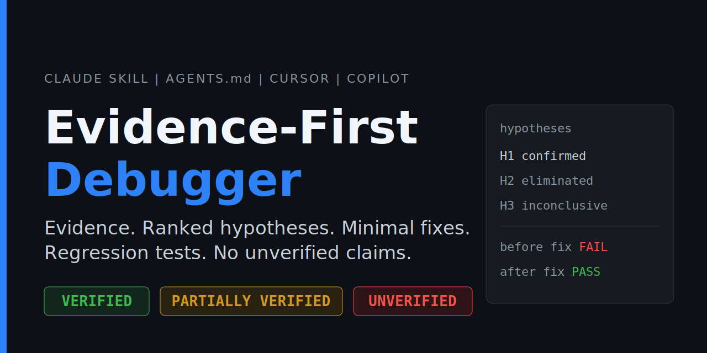
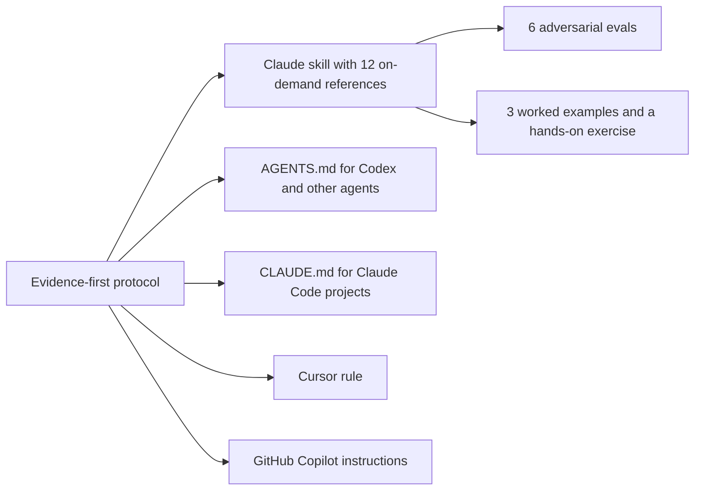
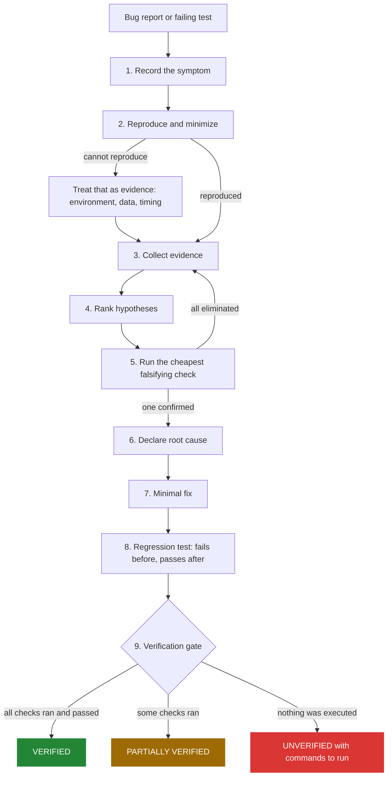
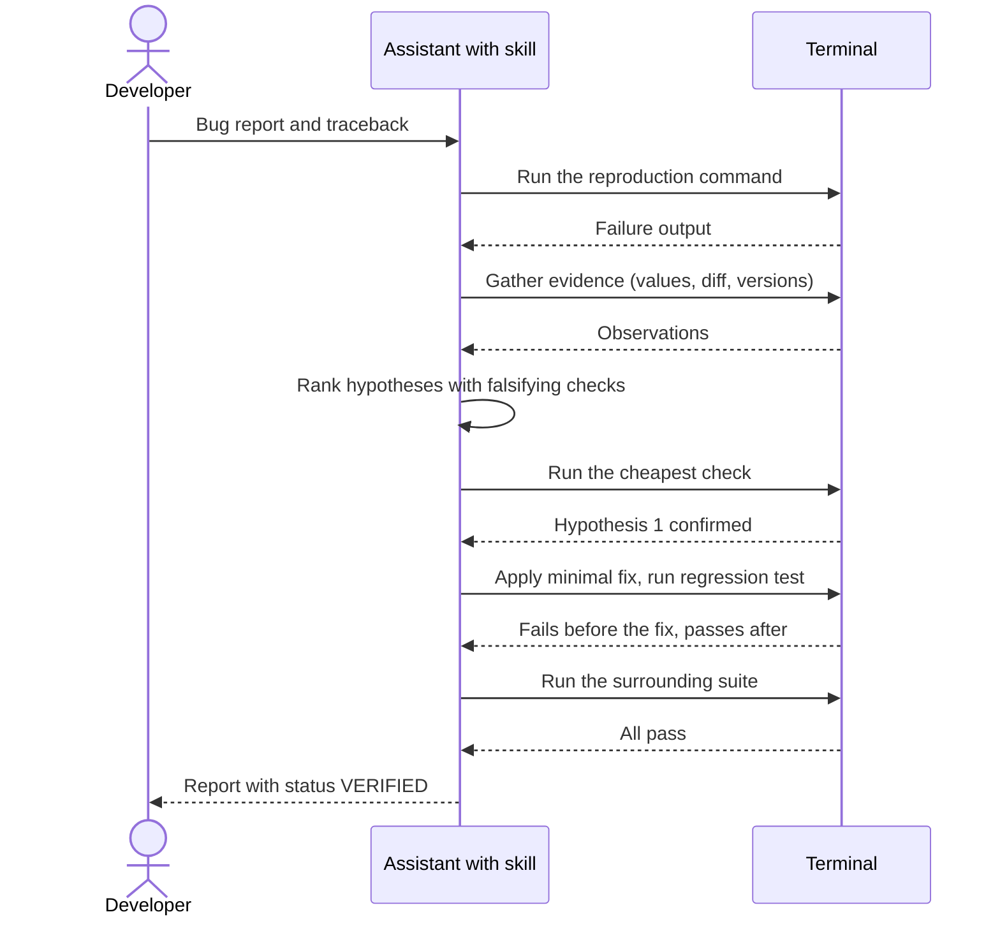
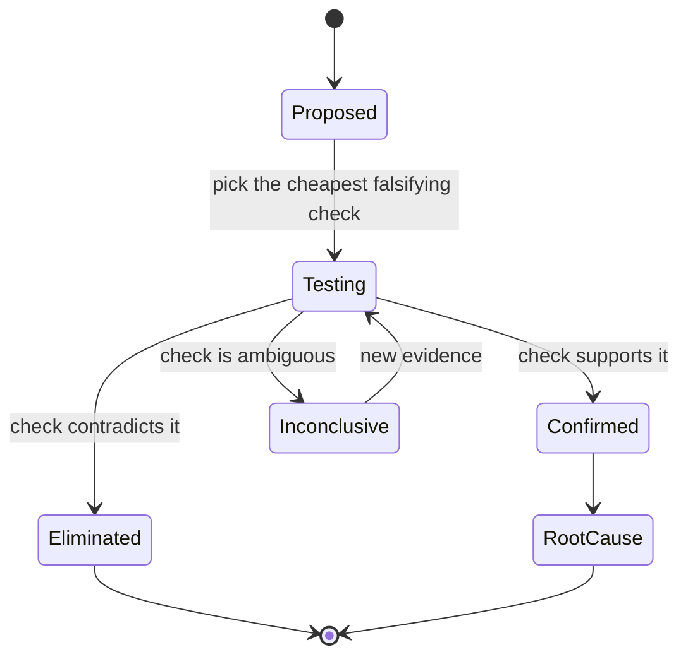
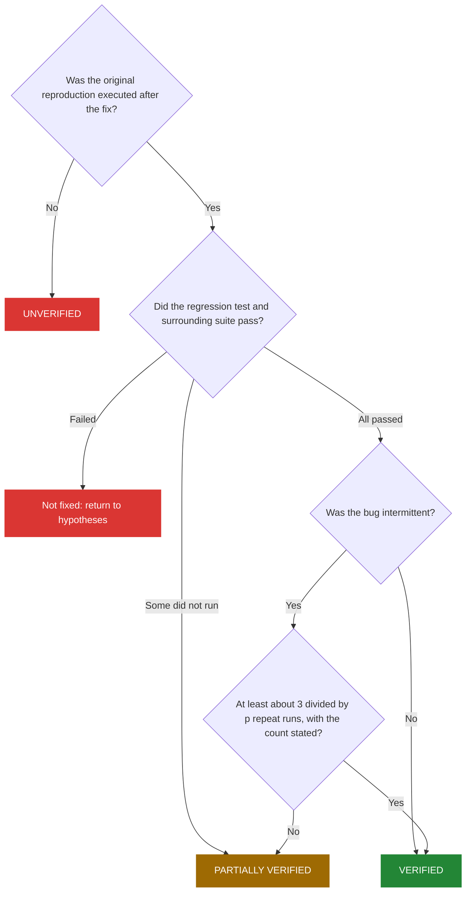
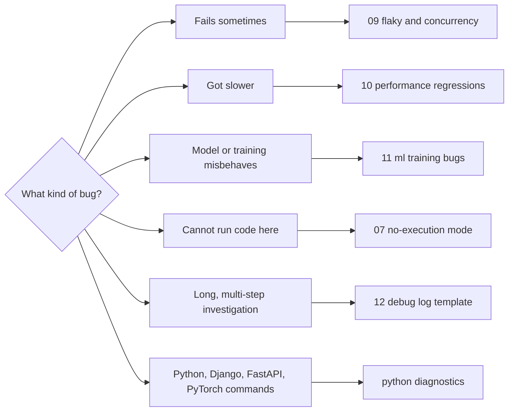
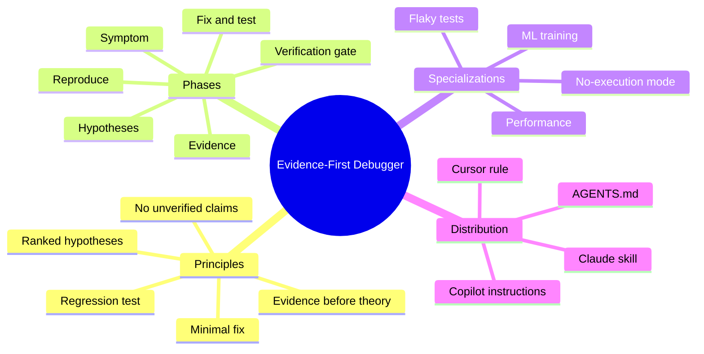

<div align="center">

# Evidence-First Debugger

**Stop AI assistants from saying "this fixes it" when nothing was run.**

Observe. Rank hypotheses. Fix minimally. Prove it with a test. Report an honest status.


[Why](#why) | [What](#what-it-is) | [How it works](#how-it-works) | [Try it](#try-it-in-60-seconds) | [How to use](#how-to-use) | [Pick a reference](#pick-the-right-reference) | [FAQ](#faq) | [Contribute](#contributing)



</div>

---

## Why

Ask an assistant about a `KeyError` and a typical answer is:

```python
user_id = payload.get("user_id")   # "This fixes the error."
```

Nothing was run. The failure has only moved: the next line now receives `None`. There is no explanation of why the key was missing, and no test.

Four things go wrong again and again:

| Failure pattern | Consequence |
|-----------------|-------------|
| Cause guessed from the first symptom | Time spent fixing the wrong thing |
| Symptom patched (`.get()`, blanket `try/except`) | The bug moves somewhere harder to find |
| No regression test, or a test that passes on the buggy code | The bug returns |
| Success claimed without execution | You discover the failure later, in production |

This project replaces guessing with a short, checkable protocol.

<details>
<summary>Typical answer versus evidence-first answer (click to expand)</summary>

| Typical assistant answer | With Evidence-First Debugger |
|--------------------------|------------------------------|
| Proposes a cause from the first symptom | Reproduces and collects evidence before naming a cause |
| One confident explanation | At least two ranked hypotheses, each with a falsifying check |
| Patches the symptom | Minimal fix aimed at the confirmed root cause |
| No test, or a test that passes on the buggy code | Regression test that fails before the fix and passes after |
| "This fixes it" | One of `VERIFIED`, `PARTIALLY VERIFIED`, or `UNVERIFIED` |
| One passing run on a flaky bug counts as success | Repeated runs required, with the run count stated |

Full side-by-side: [examples/before-after.md](examples/before-after.md).

</details>

## What it is

One protocol, shipped in the format each tool understands.



The five principles:

1. **Evidence before theory.** No cause is proposed until something has been observed.
2. **Ranked hypotheses.** At least two to three candidates, each with a falsifying check.
3. **Minimal fix.** Only the change the confirmed root cause requires.
4. **Regression test.** Must fail on the original code and pass on the fixed code.
5. **No unverified success claims.** A fix is a hypothesis until executed.

## How it works

### The workflow



### A debugging session



### Life of a hypothesis



### Which status do I report?



Here `p` is the original failure rate. If a test failed 1 run in 10 (`p = 0.1`), about 30 clean runs are needed.

| Status | Meaning |
|--------|---------|
| `VERIFIED` | Reproduction, regression test, and surrounding suite were executed after the fix and passed. |
| `PARTIALLY VERIFIED` | Some checks ran and passed; others could not run. The report states which. |
| `UNVERIFIED` | Nothing was executed. The report supplies commands for you to run. |

Phrases such as "this fixes it" or "the bug is fixed" are forbidden unless the status is `VERIFIED`.

<details>
<summary>Phase-by-phase reference files</summary>

| Phase | Goal | Reference |
|-------|------|-----------|
| 1. Symptom and reproduction | Pin down expected vs actual; reproduce and minimize | [01-symptom-and-reproduction.md](.skills/evidence-first-debugger/references/01-symptom-and-reproduction.md) |
| 2. Evidence gathering | Collect observations, not conclusions | [02-evidence-gathering.md](.skills/evidence-first-debugger/references/02-evidence-gathering.md) |
| 3. Hypotheses | Rank candidates and run falsifying checks | [03-hypotheses.md](.skills/evidence-first-debugger/references/03-hypotheses.md) |
| 4. Fix and regression test | Minimal change; fail-before, pass-after test | [04-fix-and-regression-test.md](.skills/evidence-first-debugger/references/04-fix-and-regression-test.md) |
| 5. Verification gate | Execute everything and assign a status | [05-verification-gate.md](.skills/evidence-first-debugger/references/05-verification-gate.md) |
| 6. Report | Consistent final structure | [06-report-template.md](.skills/evidence-first-debugger/references/06-report-template.md) |

</details>

## Try it in 60 seconds

A tiny project with one deliberate bug lives in [examples/try-it](examples/try-it/README.md).

```bash
cd examples/try-it
python demo.py            # KeyError: 'qty'
python -m pytest -q       # 1 failed, 1 passed
```

Paste the traceback and `cart.py` into your assistant, once without the skill and once with it, and ask "Fix this." Then score the answer:

- [ ] Reproduced or requested the failure before proposing a cause
- [ ] Listed at least two ranked hypotheses with falsifying checks
- [ ] Rejected `item.get("qty", 1)` (it silently returns a wrong total)
- [ ] Proposed a regression test that fails before the fix
- [ ] Ended with an honest status and did not claim success without running tests

## How to use

### 1. Install

<details open>
<summary>Claude Code</summary>

```bash
git clone https://github.com/maroofiums/Evidence-First-Debugger.git
cd Evidence-First-Debugger
./install.sh            # installs into ./.claude/skills in the current directory
./install.sh --user     # or install for your user account (~/.claude/skills)
```

</details>

<details>
<summary>Claude.ai</summary>

Download `evidence-first-debugger.skill` from the [Releases](https://github.com/maroofiums/Evidence-First-Debugger/releases) page, then upload it under Settings, Capabilities.

</details>

<details>
<summary>Cursor, Codex, GitHub Copilot, and other agents</summary>

```bash
./install.sh --agents
```

This copies `AGENTS.md`, `.cursor/rules/evidence-first-debugger.mdc`, and `.github/copilot-instructions.md` into the current project.

| Tool | File used |
|------|-----------|
| Claude Code, Claude.ai | `.skills/evidence-first-debugger/` (full skill with references) |
| Claude Code (project instructions) | `CLAUDE.md` |
| Codex, other AGENTS.md readers | `AGENTS.md` |
| Cursor | `.cursor/rules/evidence-first-debugger.mdc` |
| GitHub Copilot | `.github/copilot-instructions.md` |

The agent files contain the condensed protocol. The Claude skill additionally loads detailed references on demand.

</details>

### 2. Ask

The skill triggers on bug reports, tracebacks, failing tests, unexpected output, and intermittent failures.

<details>
<summary>Prompts that work well</summary>

- "My FastAPI endpoint returns 500 for some payloads. Here is the traceback."
- "This pytest test fails about one run in ten in CI. Help me find out why."
- "Training loss becomes NaN after a few hundred steps. Here is my loss function."
- "Our Django list endpoint got slow after last week's release."
- "Review this proposed fix and tell me whether it has actually been verified."

</details>

### 3. Read the status line

Every answer ends with `VERIFIED`, `PARTIALLY VERIFIED`, or `UNVERIFIED`. If it says `UNVERIFIED`, run the commands it provides and paste the output back. The assistant will update its hypothesis table from your results.

## Pick the right reference

The skill loads specialized guidance only when the bug calls for it.



| Reference | Use when |
|-----------|----------|
| [07-no-execution-mode.md](.skills/evidence-first-debugger/references/07-no-execution-mode.md) | Code cannot be run in the current environment |
| [08-failure-modes.md](.skills/evidence-first-debugger/references/08-failure-modes.md) | You want the list of common debugging mistakes |
| [09-flaky-and-concurrency.md](.skills/evidence-first-debugger/references/09-flaky-and-concurrency.md) | Intermittent failures, races, hangs |
| [10-performance-regressions.md](.skills/evidence-first-debugger/references/10-performance-regressions.md) | Slowdowns; profiling and measured before and after results |
| [11-ml-training-bugs.md](.skills/evidence-first-debugger/references/11-ml-training-bugs.md) | NaN loss, leakage, silent ML failures |
| [12-debug-log-template.md](.skills/evidence-first-debugger/references/12-debug-log-template.md) | Long investigations |
| [python-diagnostics.md](.skills/evidence-first-debugger/references/python-diagnostics.md) | Commands for Python, pytest, Django, FastAPI, PyTorch |

## Under the hood

`SKILL.md` is deliberately short. It holds the principles, the phase table, and the status rules. Each phase links to a reference file that is read only when that phase is reached (progressive disclosure), which keeps the assistant's context small.



## Examples

<details>
<summary>Worked examples (illustrative output)</summary>

- [examples/before-after.md](examples/before-after.md): a typical answer next to an evidence-first answer for the same bug.
- [examples/worked-example.md](examples/worked-example.md): FastAPI `KeyError`, with hypothesis table, regression test, and `VERIFIED` status.
- [examples/pytorch-nan-loss.md](examples/pytorch-nan-loss.md): NaN loss traced to `log(softmax(x))` underflow, with a finite-loss regression test.
- [examples/try-it](examples/try-it/README.md): a runnable exercise with a scoring checklist.

The worked examples are illustrative; their command output is representative, not copied from real runs.

</details>

## Evaluation

`.skills/evidence-first-debugger/evals/evals.json` contains six prompts with verifiable expectations, including adversarial cases such as "the error message changed, so it's fixed, right?" and "I added a sleep and it passes".

Measured results: _not yet published_. Run the evals with and without the skill and record real pass rates here before making any performance claims.

## FAQ

<details>
<summary>Does it make the model run my code?</summary>

No. A skill cannot force execution. When the assistant cannot run code, it must report `UNVERIFIED` and give you the exact commands to run. When it can run code, it must run the reproduction and tests before claiming success.

</details>

<details>
<summary>Is this only for Python?</summary>

The method is language-independent. The bundled diagnostics reference focuses on Python, pytest, Django, FastAPI, and PyTorch. Contributions for other languages are welcome.

</details>

<details>
<summary>Will it slow down simple bugs?</summary>

For small, obvious bugs the report compresses to six lines: symptom, evidence, root cause, fix, test, status.

</details>

<details>
<summary>How is this different from a generic "think step by step" prompt?</summary>

It adds requirements that can be checked: falsifiable hypotheses, a regression test that fails first, and a fixed vocabulary of verification statuses with forbidden phrasing.

</details>

<details>
<summary>The Mermaid diagrams do not render. What now?</summary>

GitHub renders Mermaid natively in the web interface and mobile app. Some editors and viewers do not; open the README on GitHub or use a Mermaid-capable markdown preview.

</details>

## Show that you use it

If a repository adopts this protocol, add this badge to its README:

```markdown
[](https://github.com/maroofiums/Evidence-First-Debugger)
```

## Contributing

Contributions are welcome, especially:

- Diagnostics references for other languages (Node.js, Go, Rust, Java)
- Additional evals, particularly cases where the skill still allows an unverified claim
- Real, measured evaluation results

See [CONTRIBUTING.md](CONTRIBUTING.md) and the [Code of Conduct](CODE_OF_CONDUCT.md). If you find a failure, open a [skill gap report](.github/ISSUE_TEMPLATE/skill-gap.md).

<details>
<summary>Maintainer: publishing, validation, and repository structure</summary>

**Publishing your copy**

```bash
python scripts/validate_skill.py
git remote add origin https://github.com/maroofiums/Evidence-First-Debugger.git
git push -u origin main --tags
./scripts/setup_github.sh maroofiums/Evidence-First-Debugger   # description, topics, labels, starter issues
```

Forks can replace the username throughout with `./scripts/set_username.sh <github-username>` (it rewrites `<your-username>` placeholders only, so it is a no-op on this repository).

Pushing a tag such as `v0.4.0` triggers the release workflow, which validates the repository and attaches `evidence-first-debugger.skill` to a GitHub release.


**Validation**

```bash
python scripts/validate_skill.py
```

The script checks frontmatter, the 500-line limit for `SKILL.md`, that every reference file is linked, that relative markdown links resolve, and that `evals.json` is well formed. The same check runs in GitHub Actions on every push and pull request.


**Repository Structure**

```
evidence-first-debugger/
├── README.md
├── CHANGELOG.md
├── LICENSE
├── CONTRIBUTING.md
├── CODE_OF_CONDUCT.md
├── AGENTS.md                           # portable instructions (Codex, Cursor, others)
├── CLAUDE.md                           # Claude Code project instructions
├── install.sh
├── assets/social-preview.png
├── docs/launch/                        # launch kit and GitHub setup notes
├── .cursor/rules/evidence-first-debugger.mdc
├── .github/
│   ├── workflows/validate.yml          # CI: structure, link, and eval checks
│   ├── ISSUE_TEMPLATE/skill-gap.md
│   ├── copilot-instructions.md
│   └── pull_request_template.md
├── scripts/
│   └── validate_skill.py
├── .skills/
│   └── evidence-first-debugger/
│       ├── SKILL.md                    # entry point: principles, workflow table, statuses
│       ├── evals/evals.json            # six test prompts with verifiable expectations
│       └── references/
│           ├── 01-symptom-and-reproduction.md
│           ├── 02-evidence-gathering.md
│           ├── 03-hypotheses.md
│           ├── 04-fix-and-regression-test.md
│           ├── 05-verification-gate.md
│           ├── 06-report-template.md
│           ├── 07-no-execution-mode.md
│           ├── 08-failure-modes.md
│           ├── 09-flaky-and-concurrency.md
│           ├── 10-performance-regressions.md
│           ├── 11-ml-training-bugs.md
│           ├── 12-debug-log-template.md
│           └── python-diagnostics.md
└── examples/
    ├── before-after.md
    ├── worked-example.md
    ├── pytorch-nan-loss.md
    └── try-it/                     # runnable exercise with a deliberate bug
```


</details>

## License

Released under the [MIT License](LICENSE).
